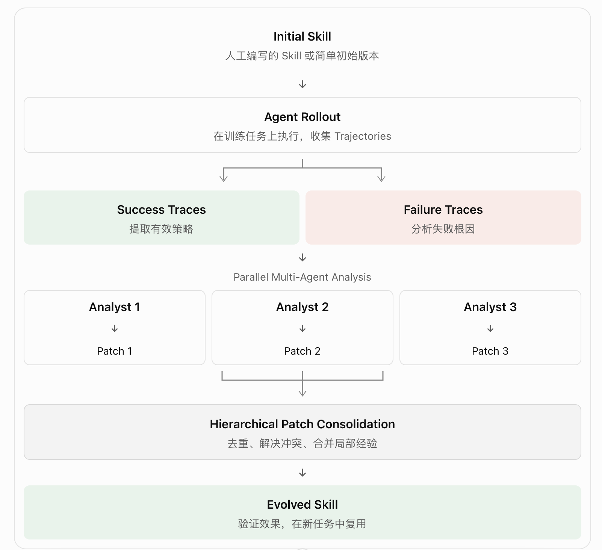
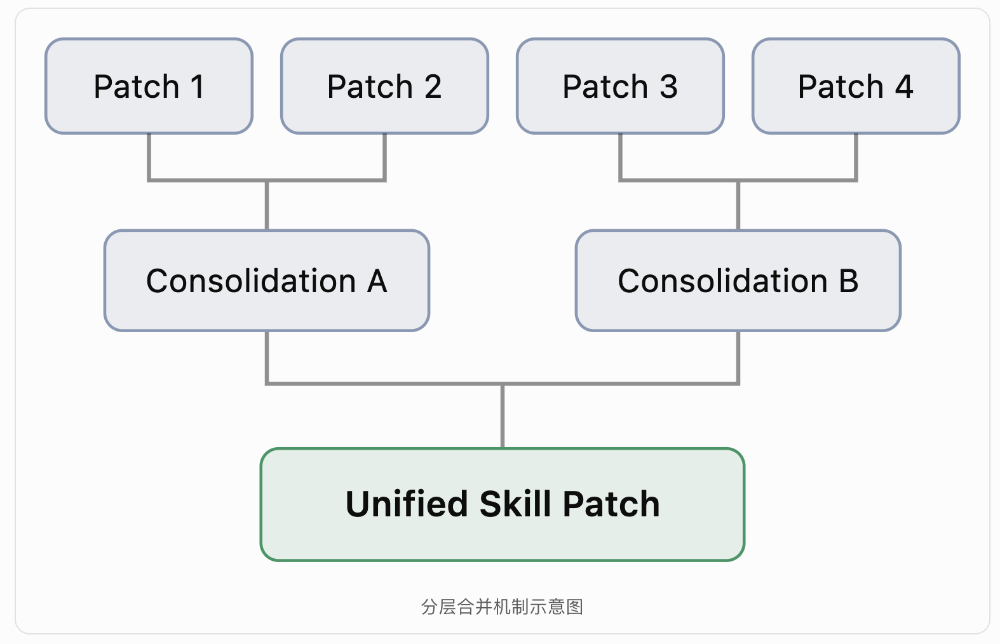
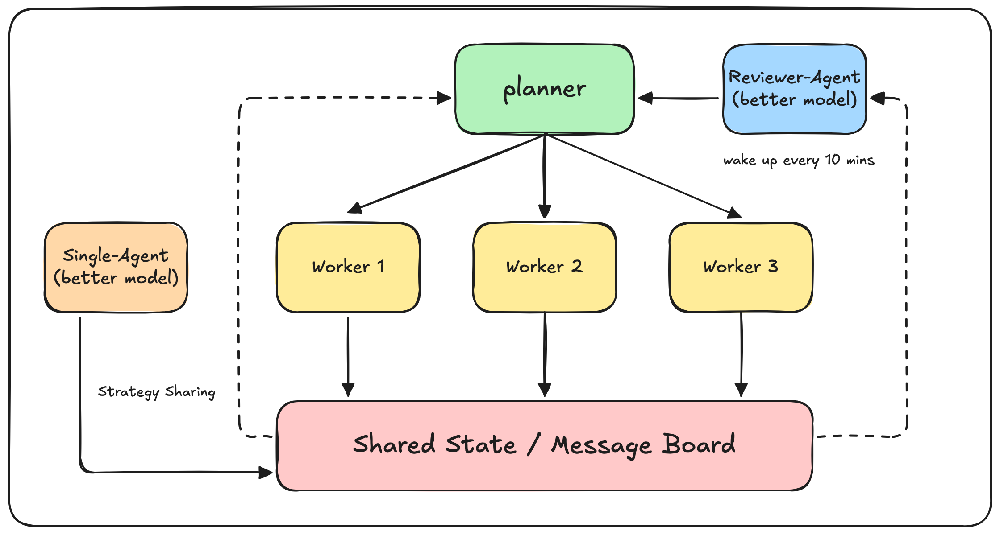
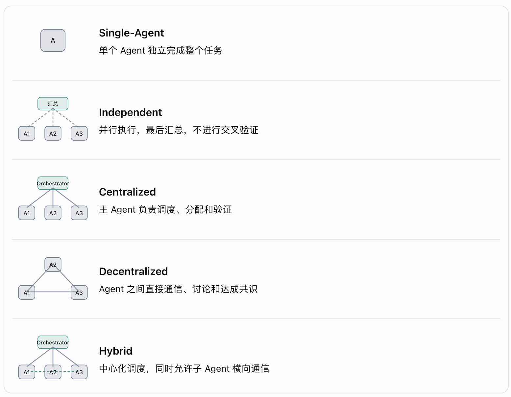
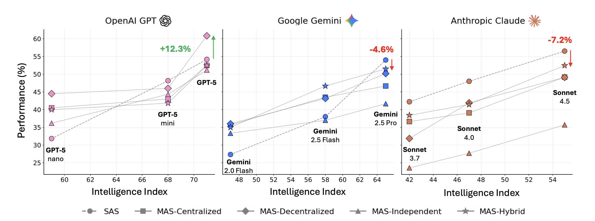
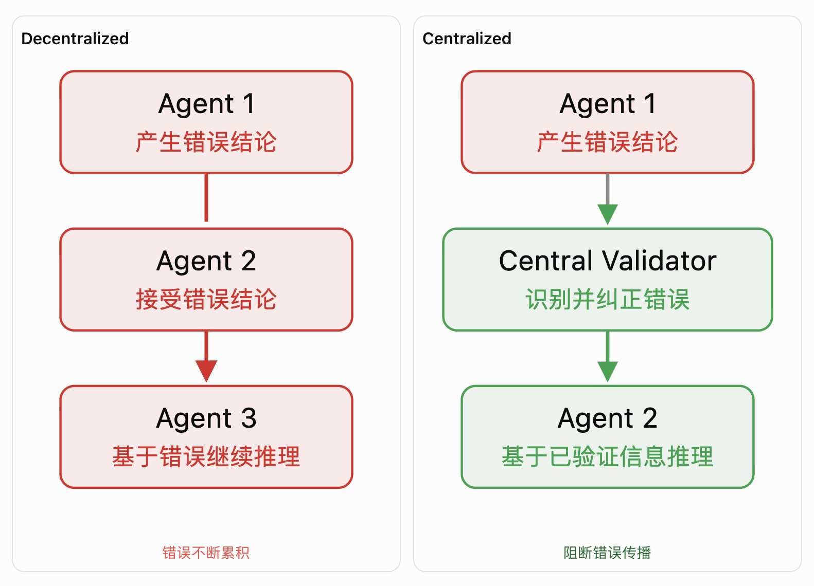
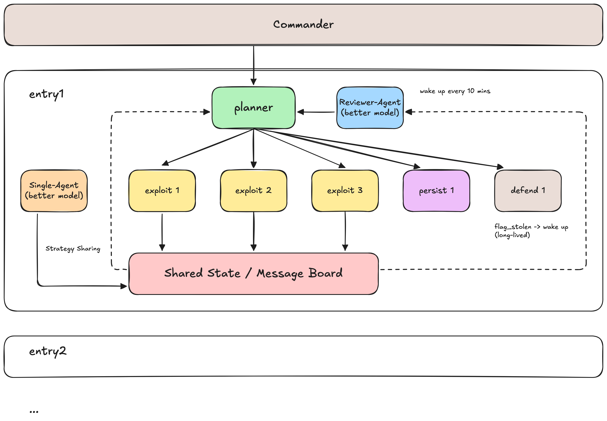
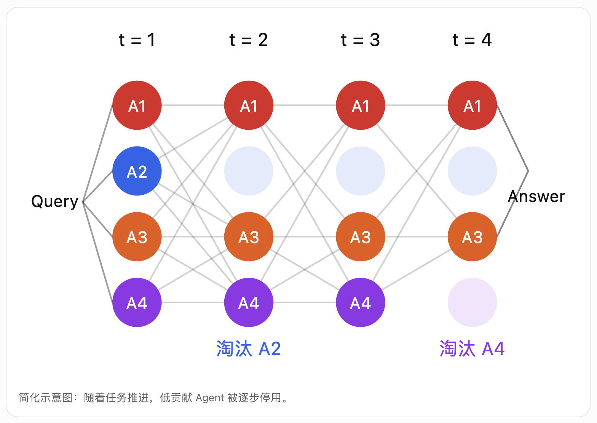
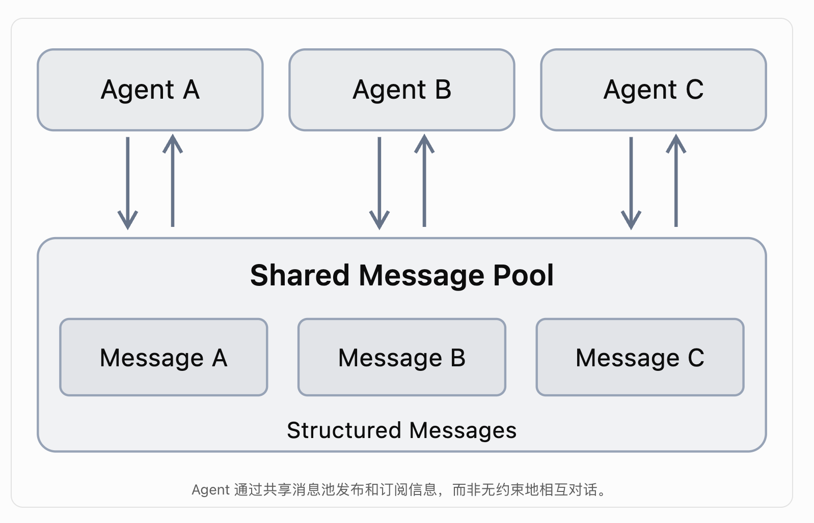

## 写在前面

首先感谢腾讯云鼎实验室的支持，助力我从🇩🇪飞回深圳参加这次活动。

我们团队“薄肌黄毛会点AI”开发了自主攻防智能体 DrawYourSword（也是海克斯大乱斗中“拔剑”海克斯的英文名！），最终在决赛中取得了第四名。

## 比赛介绍
这次决赛从初赛的靶场解题、获取 Flag 模式，升级为更具对抗性的 KoH（King of the Hill）模式。12 支队伍在同一套渗透测试靶场中展开实时攻防；每个检查点到来时，谁能在服务器上留下自己的 Flag，谁就能获得相应的分数。

这意味着，我们的 Agent 不能再只是一个能够独立解题、获取 Flag 的工具，而必须成为一个能够实时感知环境变化、快速做出决策并采取行动的自主攻防系统。它不仅需要具备漏洞发现与利用能力，还需要实现持久化控制、清除对手的恶意进程，并在持续对抗中守住已经取得的优势。

## 设计哲学
废话不多说，这里主要谈谈我们在实践中总结出的两个设计哲学。

1. 均衡之道。均衡，存于万物之间（不好意思串台了）。
2. 极简主义。

首先来谈均衡之道。说得直白些，就是如何平衡 Agent 自身能力和人为约束。这里简单列举几个真实场景：

1. 智能体编排是写死逻辑，还是由 LLM 自主安排？
2. 向服务器中写入维持权限的脚本时，是编写固定工具，还是通过 Skill 让 LLM 自行调度？
3. 面对比赛中的突发情况（如服务器重启、服务器被他人占领），是由固定脚本启动 Agent 来解决，还是让 LLM 根据环境作出相应决策？

这里先不给出具体答案，后文会逐一讲述我的设计思路。

再来谈极简主义。随着模型不断更新，Harness 的迭代速度也非常快。如果过度规范一个渗透测试 Agent 的框架，那么随着模型能力的提升，这套框架可能很快就会被淘汰。因此，从顶层设计的角度看，我认为渗透测试 Agent 应该尽量符合通用 Agent 的设计框架，而专有领域知识则应尽可能通过 Skill 等方式加载。

## 初赛的一些尝试 -- Trace2Skill
初赛是比较单纯的解题模式，具体的解题架构会在后文展示，这里先谈谈我们的一些巧思。
由于比赛采用黑盒形式，我们只能尽量设计通用的 Agent；但与此同时，通过 Skill 加载已有的专业知识，也是提升 Agent 能力的关键。
我们的想法是：Agent 在解题过程中犯的错误、踩过的坑，很可能是共通的。那么，能否从已有靶场的 Trace 中提取这些踩坑经验，转化为专业知识或约束，再存入 Skill 来辅助解题？

那么问题来了：我们从哪里获取大量高质量的 Trace？

我们发现，[BoxPwnr-Traces](https://github.com/0ca/BoxPwnr-Traces) 这个开源项目正好可以满足需求。它记录了大量靶场刷题 Trace，可以用于后续的 Trace2Skill 转换过程。
接下来的问题是：什么样的经验才算好经验？

如果轻易将某条经验加入 Skill，反而可能影响 Agent 的泛化能力；只有适用于多个场景的经验，才算得上好经验。针对渗透测试场景，我的实际处理方式是：相似经验至少要在三个不同的靶场中出现过，才会予以考虑，最后再交给 Mythos 进行 Skill Validation。

在进行初步调研后，我们阅读了 [Trace2Skill](https://github.com/Qwen-Applications/Trace2Skill) 这篇论文。它的核心思路是：让 Agent 从大量成功和失败的执行轨迹（Trajectory）中自动提炼经验，并将其转化为可复用、可持续进化的 Skills，而不需要更新模型权重。

这篇论文的 Motivation 也很直观：

- 每次执行任务都是相对独立的，过去的经验难以积累。
- 人工编写的 Skills 难以覆盖所有边界情况。
- 直接存储历史 Trajectory 会消耗大量 context，而且缺乏泛化能力。
- 根据每条 Trajectory 串行更新 Skill，可能导致后面的修改破坏前面已经积累的经验。

显然，这套方案非常适合我们当时的刷题场景：通过一个“Playbook”来提升模型能力。

原论文通过分层合并，将多个局部 Patch 整合成统一的 Skill，处理重复内容和相互冲突的指导规则。这种设计的优势在于避免串行修改过程中出现的经验覆盖、遗忘和顺序依赖问题。

### 解题框架设计
从我目前的实践经验来看，渗透测试 Agent 更适合中心化规划、去中心化执行的架构。

我们的架构设计如下：

- **Planner**：负责全局规划和任务分配。
- **Worker Agents**：自主探索，通过 Shared State 共享信息。
- **Reviewer Agent**：使用更强的模型，每隔 10 分钟审查全局进展，并为 Planner 提供策略建议。
- **Single-Agent**：使用更强的模型独立探索，作为双保险，同时与 Multi-Agent 系统共享探索思路。

虽然直觉上 Hybrid 架构可能更有效，例如 Recon Agent 发现新信息后直接通知 Exploit Agent，但这里有几个问题需要考虑：

- 信息最终还是需要持久化。
- Agent 之间频繁通信会增加 token 开销。
- Agent 在执行任务的过程中接收外部信息，是否会干扰原有的推理过程？这是一个值得研究的问题。

因此，我们选择通过 Shared State / Message Board 汇总各个 Agent 的发现，使信息共享更加清晰，也方便 Planner 进行全局决策。

纯 Decentralized 的问题在于缺乏全局视角，容易出现重复探索和错误传播；而纯 Centralized 又容易让 Planner 成为整个系统的瓶颈。

考虑到单 Agent 有时会表现得更好，我们在渗透测试部分加了一道双保险。这个设计最初源于开发过程中的直觉：如果线索过多，Planner 可能会抓不住重点，正确探索路径的优先级也未必能被及时提高；反而是一次干净、独立的探索，有时更容易快速发现正确路径。

[Towards a Science of Scaling Agent Systems](https://arxiv.org/pdf/2512.08296) 这篇技术报告对比了五种 Agent 架构：Single-Agent、Independent、Centralized、Decentralized 和 Hybrid。

论文里有些结论很有趣，这里简单罗列几点：

- 单 Agent 越强，多 Agent 的边际收益越低
- 中心化验证可以降低错误传播
- 协作机制越复杂，不代表效果越好
- Agent 架构选择具有一定可预测性

先来看第一个结论：单 Agent 越强，多 Agent 的边际收益越低。这里存在一个反直觉的现象：当单 Agent 的任务成功率超过约 45% 时，多 Agent 反而更容易产生负收益。对于渗透测试来说，单 Agent 的能力其实已经很强，如果进行过度编排和优化，反而可能成为负担。

下面这张图主要展示了不同类型的 Agent 协作架构与任务性能之间的关系。可以看到，有时 Multi-Agent 反而不如 Single-Agent。这说明引入协作不一定能带来收益，协调成本、重复探索和错误传播可能抵消并行推理的优势。可能的原因包括 Context Fragmentation（完整上下文被分割给不同 Agent）、Information Loss（思路共享过程中丢失关键细节）和 Error Propagation（错误结论在 Agent 之间传播）等。

这篇技术报告还有一个比较有意思的结论：中心化验证可以降低错误传播。这也是我们后来在设计中加入 Reviewer 的原因。

协作机制越复杂，并不代表效果越好。

此外，Agent 架构的选择还具有一定的可预测性。

当然，随着模型能力的提升，最优的 Agent 架构也可能发生变化。这也是为什么我认为 Agent 的设计应该往通用化方向发展。

当模型能力足够强时，我们需要做的可能不再是设计复杂的工作流，而是为不同 Agent 构建高效、可靠的沟通桥梁。

任何过度依赖当前模型能力、难以灵活调整的架构，都可能随着模型的迭代而逐渐失去优势。

## KOH框架设计

KoH 框架与解题框架最大的区别，是我们引入了专职化 Worker。

为什么要使用专职化 Worker？我们希望不同的 Worker 能处理不同任务，通过定制的 System Prompt 对行为进行约束，同时读取各自专属的 Skills。这里其实体现了解耦的思想：我们仍然以通用 Worker 为基础，只在上层加入必要的行为规范。

解决了定制问题，接下来就是如何编排这些 Worker。

我们的选择是动态编排。

具体来说，我们采用了“固定脚本 + LLM 动态分配”的双保险方式。首先，recon -> exploit -> persist -> patch 这一流程必须完整走完；此后再由 LLM 根据赛场情况动态分配任务，比如让某个服务器始终挂着一个 Defend Worker。

我们设置了一个总指挥 Agent（Commander），由它根据赛场情况进行安排，并与各个 Task 的 Planner 直接通信。比如某个 Server 的环境被重置后，Commander 会向 Planner 下达命令，后者应当立刻分配一个 Worker，准备重新抢占 Hill。

其实比赛时我还没有读到这篇论文，这里分享它，是因为我们的思路不谋而合：Dynamic Multi-Agent Architecture——A Dynamic LLM-Powered Agent Network for Task-Oriented Agent Collaboration。
传统 Multi-Agent 系统存在两个问题：

- Agent 的角色和数量通常是预先固定的。
- Agent 之间的通信结构在任务执行过程中基本不变。

DyLAN 认为，不仅应该根据任务动态选择 Agent，还应该根据 Agent 在实际协作过程中的贡献，动态调整团队组成和通信结构。一个有意思的创新是，它借鉴了神经网络的前向传播、反向传播和节点重要性评估机制，将 Multi-Agent 系统抽象成动态计算图。

这与我们动态选择 Agent 的思路一致，但我们的场景并不需要如此复杂的 Agent 优化机制。

## Agent 间的通信 & Message Board

针对我们的场景，我认为 Shared Message Board 是更合适的选择，我们最终也确实采用了类似策略。具体思路可以参考 [MetaGPT](https://arxiv.org/pdf/2308.00352) 这篇论文。

[AutoGen: Enabling Next-Gen LLM Applications via Multi-Agent Conversations](https://arxiv.org/pdf/2308.08155) 也介绍了一些常见的 Agent 通信方式，感兴趣的同学可以读一下：

- Sequential: Agents communicate then handoff to the next team for the next step.
- Nested: Subagents communicate directly to managers.
- Group Chat: Shared context amongst agents in a group.
- Hierarchical Chat: All subagents communicate to orchestrator.
- Current patterns in AutoGen: RoundRobinGroupChat, SelectorGroupChat, Swarm, ...

## 一些优化和难点的处理

### 1. 错误信息的长期驻留与传播

Message Board 降低了 Agent 之间的信息共享成本，但也放大了错误信息的影响，使单个 Worker 的误判可能演变为整个团队的错误共识。

例如，某个 Worker 在尝试验证 SQL 注入时失败，并在 Message Board 中记录“此处不存在 SQL 注入”。后续 Worker 读取到的只是结论，而非完整的验证过程和证据。即使环境发生变化，或者此前的验证方法本身存在问题，后续 Worker 也可能直接跳过这条线索，导致错误判断长期驻留在系统的共享记忆中。

Anthropic 在《宝可梦 红》的实验中记录过类似的现象。Claude 错误地将宝可梦中心的位置记录在月见山的另一侧，误以为自己已经穿过山洞，导致它三次从同一处台阶跳回原来的路线。直到重新检查原始记录、纠正记忆中的错误信息后，Claude 才恢复了正确的行动方向。参考：[The Components of Agent Memory](https://www.anthropic.com/research/components-of-agent-memory?utm_source=chatgpt.com)。

针对这一问题，我认为可以从三个方面进行设计：

- **规范信息写入（Skill）：** 永远不把结论写死。可以写“SQL 注入尝试失败”，而不能写“这里不存在 SQL 注入的可能”。
- **引入记忆审查（Reviewer）：** 定期审查 Message Board 中的关键结论，进一步减小有效路径被堵死的情况出现的概率。
- **建立记忆失效机制（Memory Invalidation）：** 当环境发生变化，或团队长时间没有取得进展时，重新评估依赖历史条件的判断。保留原始观察，但将部分结论重新标记为待验证状态。

核心思想是：**共享记忆不应该只是一个不断累积信息的存储空间，而应该是一个能够持续修正、更新和重新验证的知识系统。**

### 2. Worker 设计模式的优化

以 Defender Worker 为例，我最初倾向于将一些防御策略直接封装成固定工具。这种设计在面对已知场景时具有较高的执行效率，但也存在明显的局限性：工具中隐含的假设可能随着对手攻击策略的变化而失效。

后来我们将 Worker 的设计拆分为两个层次：

- **Tool（执行层）：** 将高频、稳定、可复用的操作封装为工具，保证执行效率和可靠性。
- **Skill（决策层）：** 将判断依据、适用条件、工具选择策略以及历史经验沉淀到 Skill 中，由 Agent 根据当前环境动态决策。

从长期来看，Worker 的设计应该逐渐从面向特定场景的固定 Workflow，转向 **General-purpose Agent + Domain-specific Skills + Reusable Tools** 的模式。随着模型能力的提升，我们可以逐步减少硬编码的决策逻辑，让模型承担更多环境感知、策略选择与动态调整的工作，同时保留工具层确定性的执行能力。

## 其他
- 为了方便调试并防止过拟合，我们复刻了一套与比赛环境完全一致的靶场。
- 测试时，我们会单独验证每个 Worker 的能力。
- 我们还让 Worker 与拥有服务器权限的 Claude 对抗，并在对抗过程中迭代优化各个 Worker。
- 我们还加入了蜜罐（设计了但好像没起到太大的用处），有兴趣的同学可以自行探索。

## 写在最后

AI 时代更不能浮躁，有人把关的技术才有灵魂。

鑫总也说，在 AI 时代，藏着掖着没有任何意义，如何通过开源和分享推动整个社区的发展才是重要的。

鑫总还说，长江后浪推前浪 😂

作为年轻人得好好干啊。

### 参考文献
- https://www.anthropic.com/research/multi-agent-research-system?trk=feed-detail_main-feed-card_feed-article-content
- https://github.com/0ca/BoxPwnr-Traces 
- https://github.com/Qwen-Applications/Trace2Skill
- [Towards a Science of Scaling Agent Systems](https://arxiv.org/pdf/2512.08296)
- [A Dynamic LLM-Powered Agent Network for Task-Oriented Agent Collaboration](https://arxiv.org/pdf/2310.02170)
- [AutoGen: Enabling Next-Gen LLM Applications via Multi-Agent Conversation](https://arxiv.org/pdf/2308.08155)
- https://www.anthropic.com/research/components-of-agent-memory

